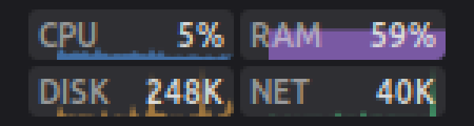

<div align="center">

# cinnastat

**CPU, memory, disk and network in a tiny 2×2 display on your Linux Mint panel.**

One glance at the panel tells you whether the machine is busy, and why: a runaway process, memory
running out, a disk working hard or a big download. No terminal, no window to open.

[](https://github.com/hugoamadio/cinnastat/actions/workflows/ci.yml)
[](LICENSE)




<sub>Actual size is 132×34 px, shown here at 4×.</sub>

</div>

## What it shows

| Cell | Value | Graph |
| --- | --- | --- |
| **CPU** | busy time across all cores | last ~minute |
| **RAM** | memory in use (what the kernel can't hand out right now) | last ~minute |
| **DISK** | read + write per second, all physical disks | scales to the busiest moment on screen |
| **NET** | download + upload per second, all physical interfaces | scales to the busiest moment on screen |

Hover for the details:

```
CPU 12% · load 1.20 0.95 0.80
Memory 59% · 18.5 GB of 31.1 GB · swap 2.8 GB
Disk read 16.0 KB/s · write 2.5 MB/s · / 48% full, 150 GB free
Network ↓ 4.9 MB/s · ↑ 85.0 KB/s
```

Click to open System Monitor on its Resources tab.

## Install

```bash
git clone https://github.com/hugoamadio/cinnastat.git
cd cinnastat
./install.sh
```

Then right-click the panel → **Applets**, select **cinnastat** and click **+**. Drag it where you want it
while the panel is in edit mode.

To update, `git pull` and run `./install.sh` again. To uninstall, `./install.sh --remove`.

## Settings

Right-click → **Configure**:

| Setting | Default |
| --- | --- |
| Update every | 1000 ms |
| Width on a horizontal panel | 132 px (height follows the panel) |
| Colors | blue CPU, purple RAM, orange disk, green network |
| Command to run on click | `gnome-system-monitor -r` (empty = do nothing) |

The display follows the panel: its height tracks the panel height, on a vertical panel it becomes a
square as wide as the panel, and the text uses your theme's panel font and color.

## Why it is light

- **No dependencies.** Everything comes from `/proc` (`stat`, `meminfo`, `diskstats`, `net/dev`), the same
  files `top` and `free` read. No Python, no `libgtop`, no background daemon.
- **Five tiny file reads per second** and one small redraw. It lives inside Cinnamon, so it adds no process.
- **Honest totals.** Only real hardware is counted: physical disks (not loop devices, partitions or LVM/LUKS
  layers on top of them) and physical network cards (not `lo`, Docker bridges, `veth` pairs or VPN tunnels).
  Traffic that crosses a VPN or a container network is counted once, on the card that actually sent it.

## Development

```bash
./install.sh --link       # symlink, so your edits are live after a reload
node --test test/*.test.js
```

Reload the applet after editing:

```bash
dbus-send --session --dest=org.Cinnamon.LookingGlass --type=method_call /org/Cinnamon/LookingGlass \
  org.Cinnamon.LookingGlass.ReloadExtension string:cinnastat@hugoamadio string:APPLET
```

The parsers in [`stats.js`](files/cinnastat@hugoamadio/stats.js) are plain JavaScript with no Cinnamon
imports, so the tests run under Node. Errors from the applet show up in `~/.xsession-errors` and in Looking
Glass (`Alt+F2`, `lg`).

Tested on Linux Mint 22.3 with Cinnamon 6.6. Issues and pull requests are welcome.

If cinnastat earns its spot on your panel, a ⭐ helps other Mint users find it.

## License

[MIT](LICENSE)
